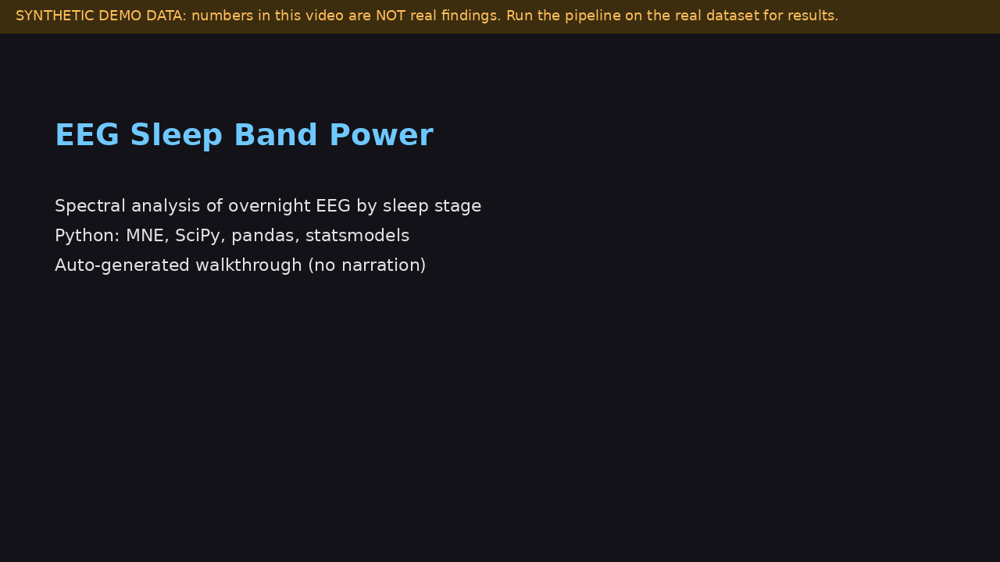

# EEG Sleep Band Power

Spectral analysis of overnight EEG across sleep stages using PhysioNet Sleep-EDF, with subject-level statistics and false-discovery-rate control.

**Demo video:** [docs/demo.mp4](docs/demo.mp4) is an auto-generated, captioned walkthrough (no narration) rendered from the real commands and figures in this repo. It uses synthetic recordings (`--synthetic`), so its numbers are not findings about real sleep. Re-render it with `python scripts/make_demo_video.py` (needs `pillow` and `ffmpeg`). A narrated recording can replace it: upload to YouTube and change the link above.

## Question

How does relative EEG band power (delta, theta, alpha, sigma, beta) differ between sleep stages, and do the differences hold up when the subject, not the epoch, is the unit of inference?

## Data

Sleep-EDF Expanded, sleep-cassette study (healthy-age subjects), PhysioNet. Downloaded through mne.datasets.sleep_physionet. Channel EEG Fpz-Cz, 100 Hz, first night, 30-s epochs scored by human experts. Check the dataset page for current license terms.

- Kemp B et al. Analysis of a sleep-dependent neuronal feedback loop: the slow-wave microcontinuity of the EEG. IEEE Trans Biomed Eng, 2000.
- Goldberger AL et al. PhysioBank, PhysioToolkit, and PhysioNet. Circulation, 2000.

## Method

1. Zero-phase FIR band-pass 0.3-35 Hz.
2. Cut into 30-s epochs by the hypnogram (R&K stages 3 and 4 merged into N3).
3. Reject epochs with peak-to-peak amplitude above 500 uV (configurable).
4. Welch PSD (4-s Hann windows, 50 percent overlap); relative power in delta 0.5-4, theta 4-8, alpha 8-12, sigma 12-16, beta 16-30 Hz, normalised to 0.5-30 Hz.
5. Median per subject per stage. Friedman test across stages; paired Wilcoxon of each stage vs wake; Benjamini-Hochberg across all band x stage tests.

## Run

    python -m venv .venv && source .venv/bin/activate
    pip install -r requirements.txt
    pytest
    python scripts/run_pipeline.py --subjects 0-9 --out results

First run downloads roughly 50 MB per subject. For a no-download demo on synthetic recordings (numbers are NOT real findings): `python scripts/run_pipeline.py --synthetic --subjects 0-7`.

## Tests

Tests run offline. They check that pure sinusoids land in the right band, relative power sums to 1 and is amplitude-invariant, the PSD satisfies Parseval, artifact rejection works, and an end-to-end synthetic recording with a known injected frequency per stage recovers the right dominant band per stage.

## Results

Fill this section from YOUR run (results/ and figures). Do not copy numbers from anywhere else. Textbook expectations to compare against: delta highest in N3, sigma (spindles) highest in N2, alpha highest in wake, theta relatively elevated in REM and N1. State where your results agree and where they do not.

## Evaluator problem

problems/problem_01_pseudoreplication.md shows why pooling epochs across subjects inflates false positives. In the included simulation (seed 42), pooled testing gave a false-positive rate of 0.83 against a nominal 0.05, versus 0.04 for the subject-level paired test.

## Limitations

Single channel; first night only; a subset of subjects; fixed amplitude rejection threshold with no sensitivity analysis; relative power hides absolute changes; sleep staging labels carry inter-rater variability.
