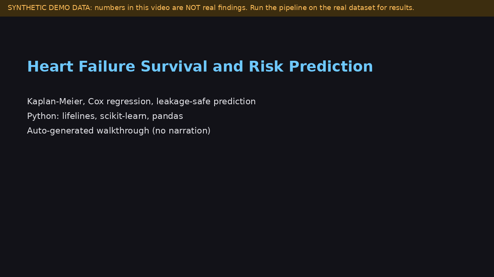

# Heart Failure Survival and Risk Prediction

Kaplan-Meier, Cox regression and leakage-safe prediction on the UCI Heart Failure Clinical Records dataset, with explicit calibration and leakage checks.

**Demo video:** [docs/demo.mp4](docs/demo.mp4) is an auto-generated, captioned walkthrough (no narration) rendered from the real commands and figures in this repo. It uses a synthetic cohort (`--synthetic`), so its numbers are not findings about real patients. Re-render it with `python scripts/make_demo_video.py` (needs `pillow` and `ffmpeg`). A narrated recording can replace it: upload to YouTube and change the link above.

## Question

Which clinical measurements are associated with death after heart failure, and how well can risk be predicted when target leakage is avoided?

## Data

Heart Failure Clinical Records, UCI Machine Learning Repository: 299 patients, 11 clinical features plus follow-up time and DEATH_EVENT. Original data: Ahmad T et al., PLoS ONE 2017. Machine-learning analysis: Chicco D and Jurman G, BMC Med Inform Decis Mak 2020. Download the CSV from the UCI dataset page (the script also tries a direct URL, which may have moved) and check the license there. Place it at data/heart_failure_clinical_records_dataset.csv.

## Method

1. Validate the schema; log-transform skewed covariates (creatine phosphokinase, serum creatinine).
2. Kaplan-Meier by ejection fraction below 40 percent, log-rank test.
3. Penalised Cox model on standardised covariates (hazard ratio per 1 SD); proportional-hazards test on rank-transformed time.
4. Repeated stratified 5-fold CV: Cox C-index, and logistic regression and random forest AUC. Transforms and scaling sit inside the pipeline.
5. Calibration curve and Brier score against the prevalence baseline.
6. Leakage demo: the same model with and without follow-up time.

## Run

    python -m venv .venv && source .venv/bin/activate
    pip install -r requirements.txt
    pytest
    python scripts/run_pipeline.py --csv data/heart_failure_clinical_records_dataset.csv

Demo on a synthetic cohort (not real patients): `python scripts/run_pipeline.py --synthetic`.

## Tests

Offline, on a synthetic cohort with the same schema: schema validation; log-rank detects the built-in ejection-fraction effect; Cox coefficient signs match the generating model; cross-validated C-index and AUC above chance; follow-up time inflates AUC; scaling is inside the pipeline.

## Results

Fill from YOUR run on the real CSV (results/ folder). Do not copy numbers from elsewhere or from the synthetic tests. Report the hazard ratios and CIs, C-index, AUC, Brier versus baseline, and the leakage inflation you observe.

## Evaluator problem

problems/problem_01_leakage.md: why follow-up time must not be a feature. On synthetic cohorts, including it inflated CV AUC by +0.095 to +0.181 across 5 seeds.

## Limitations

299 patients from one cohort; no external validation; binary classification ignores censoring (Cox is primary); no hyperparameter tuning; calibration is noisy at this size; the ejection-fraction cutoff of 40 is a clinical convention.
