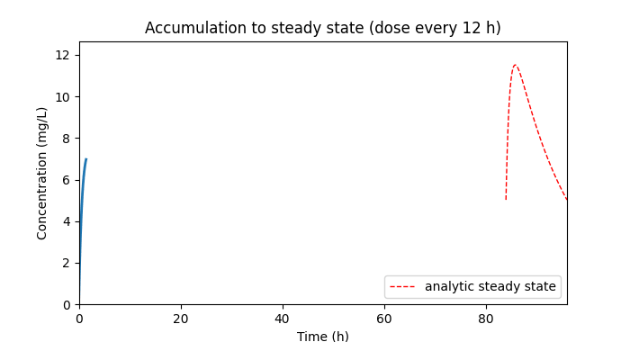
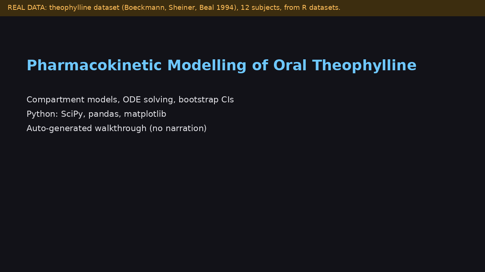

# Pharmacokinetic Modelling of Oral Theophylline

One- and two-compartment oral PK models solved in closed form and by ODE, fitted per subject, summarised with a subject-level bootstrap, and cross-checked against non-compartmental analysis.

**Demo video:** [docs/demo.mp4](docs/demo.mp4) is an auto-generated, captioned walkthrough (no narration) rendered from the real commands and figures in this repo. It runs on the real theophylline data in `data/Theoph.csv`. Re-render it with `python scripts/make_demo_video.py` (needs `pillow` and `ffmpeg`). A narrated recording can replace it: upload to YouTube and change the link above.

## Question

What are the absorption and elimination kinetics of oral theophylline, how variable are they across subjects, and which model structure do the data support?

## Data

Theophylline dataset (Boeckmann AJ, Sheiner LB, Beal SL, NONMEM Users Guide, 1994), as distributed in the R datasets package (Theoph): 12 subjects, single oral dose of about 4 mg/kg, 11 concentrations over 24 h. The copy in data/Theoph.csv comes from the Rdatasets collection; check its source page for terms.

## Method

1. Closed-form Bateman solution and an ODE solver (SciPy LSODA, rtol 1e-10) for 1- and 2-compartment models; they are tested against each other.
2. Per-subject nonlinear least squares on log concentrations (proportional error), log-parameterised, multi-start.
3. AICc comparison of 1- vs 2-compartment fits.
4. Derived: CL/F = ke x V/F, half-life, AUC(0-inf) = dose / CL/F; non-compartmental AUC as a cross-check.
5. Geometric means with percentile bootstrap CI, resampling subjects.
6. Repeated dosing by superposition, checked against the analytic steady-state profile.

## Run

    python -m venv .venv && source .venv/bin/activate
    pip install -r requirements.txt
    pytest
    python scripts/run_pipeline.py
    python scripts/make_demo_animation.py     # regenerates docs/demo.gif

## Results (my run on data/Theoph.csv)

Geometric means with subject-level bootstrap 95% CI:

| Parameter | Value | 95% CI |
|---|---|---|
| ka (1/h) | 1.36 | 0.90 to 2.23 |
| ke (1/h) | 0.088 | 0.078 to 0.097 |
| V/F (L/kg) | 0.454 | 0.419 to 0.491 |
| CL/F (L/h/kg) | 0.040 | 0.034 to 0.046 |
| Half-life (h) | 7.9 | 7.2 to 8.9 |

The 1-compartment model had lower AICc in 12 of 12 subjects. Model AUC(0-inf) was 0.95 to 0.99 of the non-compartmental value (median 0.975); the trapezoid overestimates AUC on convex declines. Subject 9 has ka near 10/h because no sample falls in the absorption phase, so its ka is weakly identified. Re-run to confirm these on your machine.

## Evaluator problem

problems/problem_01_flip_flop.md: oral data cannot distinguish (ka, ke) from (ke, ka). In the included simulation two fits with identical SSE gave half-lives of 7.1 h and 0.44 h.

## Limitations

Per-subject fits, not a population (NLME) model; one dose level; no covariates (weight is in the data but unused); 11 points per subject limit the 2-compartment model; log-scale fitting assumes proportional error.
