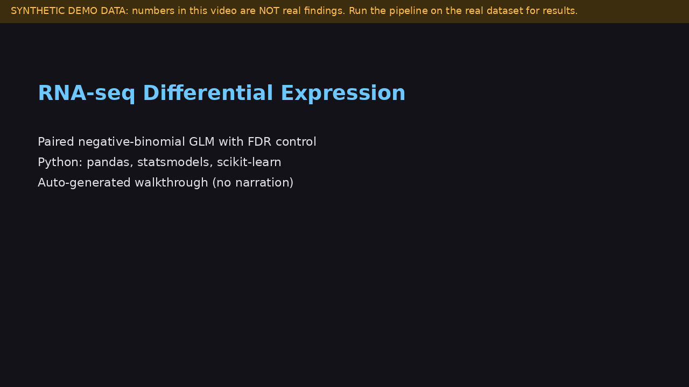

# RNA-seq Differential Expression (paired design)

A from-scratch bulk RNA-seq pipeline: filtering, median-of-ratios normalisation, negative-binomial GLM with a paired design, FDR control, and validation against published glucocorticoid-response genes.

**Demo video:** [docs/demo.mp4](docs/demo.mp4) is an auto-generated, captioned walkthrough (no narration) rendered from the real commands and figures in this repo. It uses synthetic counts (`scripts/make_synthetic_data.py`), so its numbers are not real biology. Re-render it with `python scripts/make_demo_video.py` (needs `pillow` and `ffmpeg`). A narrated recording can replace it: upload to YouTube and change the link above.

## Question

Which genes change in airway smooth muscle cells after dexamethasone, and does the pipeline recover the genes reported in the original study?

## Data

Airway dataset: Himes BE et al. RNA-Seq transcriptome profiling identifies CRISPLD2 as a glucocorticoid responsive gene that modulates cytokine function in airway smooth muscle cells. PLoS ONE, 2014 (GEO GSE52778). 8 samples: 4 cell lines, each untreated and dexamethasone-treated. The count matrix is distributed in the Bioconductor airway package; scripts/export_airway.R exports it to CSV. Check the GEO and Bioconductor pages for terms of use.

## Method

1. Drop genes with fewer than 10 reads in at least 2 samples.
2. Size factors by median-of-ratios.
3. Per-gene negative-binomial GLM: log(mu) = log(size factor) + cell line + treatment. Dispersion from a Poisson-residual moment estimate, shrunk toward a mean-dependent trend.
4. Wald test on the treatment coefficient; Benjamini-Hochberg across genes.
5. Validate: DUSP1, KLF15, PER1, TSC22D3, FKBP5 and ZBTB16 should be up-regulated and significant.

## Run

    python -m venv .venv && source .venv/bin/activate
    pip install -r requirements.txt
    pytest
    Rscript scripts/export_airway.R        # once; needs R + Bioconductor
    python scripts/run_pipeline.py --counts data/airway_counts.csv --coldata data/airway_coldata.csv

No-R demo on synthetic counts (not real biology):

    python scripts/make_synthetic_data.py
    python scripts/run_pipeline.py --counts data/synthetic_counts.csv --coldata data/synthetic_coldata.csv --factors subject treat --contrast treat --ref ctl --skip-validation

## Tests

Synthetic paired data with known truth: size factors recover depth ratios; recall above 0.85 and false-discovery proportion below 0.2 at FDR 5 percent; under the null fewer than 2 percent of genes are called; effect direction is correct.

## Results

Fill from YOUR run (results/ folder). Do not copy numbers from elsewhere. Report the number of genes at FDR below 0.05, which known genes were recovered, and what the PCA shows.

## Evaluator problem

problems/problem_01_normalisation.md: total-count normalisation under composition bias. In the included simulation (seed 7), total-count scaling falsely called 80.2 percent of non-dominant genes; median-of-ratios called 0.1 percent.

## Limitations

The dispersion model is a simplified stand-in for DESeq2 (shrinkage weight was tuned on simulated data with constant dispersion, which favours the trend). Cross-check borderline genes with PyDESeq2. Eight samples limit power. Gene-symbol collapsing merges duplicated labels. No pathway or enrichment analysis.
