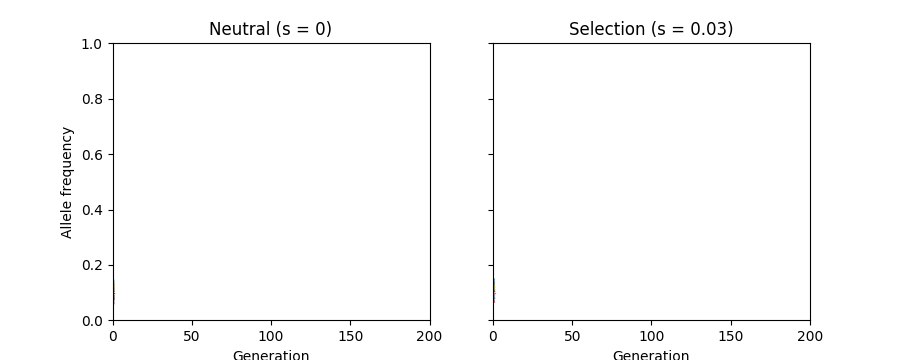
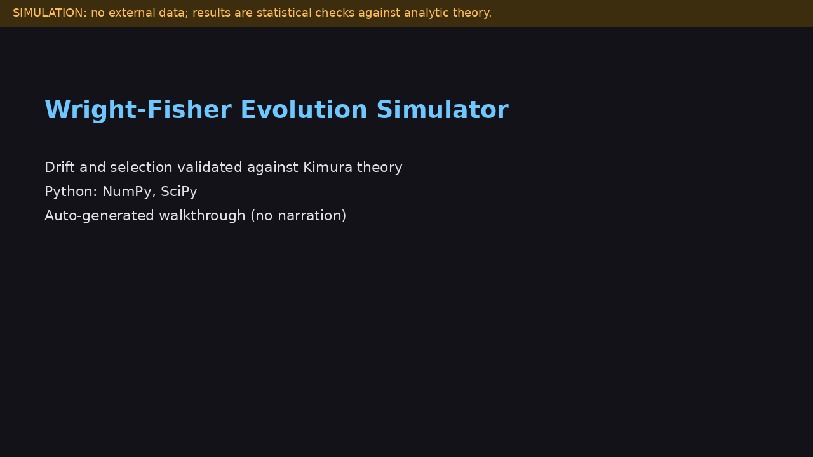

# Wright-Fisher Evolution Simulator

A vectorised simulation of genetic drift and selection at one locus, validated statistically against Kimura's diffusion results (fixation probability, time to fixation, heterozygosity decay under bottlenecks).

**Demo video:** [docs/demo.mp4](docs/demo.mp4) is an auto-generated, captioned walkthrough (no narration) rendered from the real commands and figures in this repo. It is a pure simulation; no external data. Re-render it with `python scripts/make_demo_video.py` (needs `pillow` and `ffmpeg`). A narrated recording can replace it: upload to YouTube and change the link above.

## Question

Does a Wright-Fisher simulation reproduce the analytic predictions for how drift and selection determine the fate of a new mutation?

## Model

2N gene copies. Each generation: selection p' = p(1+s)/(1+s p) (allele fitness 1+s versus 1), then drift as Binomial(2N, p'). Frequencies 0 and 1 are absorbing. Population size may vary per generation (bottlenecks).

## Theory used for validation

- Neutral fixation probability of a new mutant: 1/(2N).
- Kimura: u = (1 - exp(-4Nsp0)) / (1 - exp(-4Ns)), which approaches 2s for large Ns.
- Neutral mean time to fixation given fixation: -4N(1-p)ln(1-p)/p, about 4N for a new mutant.
- Expected heterozygosity: H_t = H_0 x product of (1 - 1/(2N_i)).

Reference: Kimura M. On the probability of fixation of mutant genes in a population. Genetics, 1962; Crow JF and Kimura M., An Introduction to Population Genetics Theory, 1970.

## Run

    python -m venv .venv && source .venv/bin/activate
    pip install -r requirements.txt
    pytest
    python scripts/run_pipeline.py
    python scripts/make_demo_animation.py     # regenerates docs/demo.gif

No data download is needed.

## Tests

Statistical tests with 4-standard-error tolerances and fixed seeds: neutral fixation probability equals 1/(2N); selected fixation probability matches Kimura; neutral fixation and loss times match theory within 10 percent; heterozygosity decay matches theory for constant N and for a bottleneck; Kimura limits; absorbing boundaries; seed reproducibility; interval edge cases.

## Results (my run: N = 50, 20000 replicates per s, seed 42)

| s | fixations | estimate | 95% CI (Clopper-Pearson) | Kimura |
|---|---|---|---|---|
| 0 | 222 | 0.0111 | 0.0097 to 0.0127 | 0.0100 |
| 0.01 | 462 | 0.0231 | 0.0211 to 0.0253 | 0.0229 |
| 0.02 | 791 | 0.0396 | 0.0369 to 0.0423 | 0.0399 |
| 0.05 | 1908 | 0.0954 | 0.0914 to 0.0996 | 0.0952 |
| 0.1 | 3532 | 0.1766 | 0.1713 to 0.1820 | 0.1813 |

Kimura's value lies inside every interval, though only just at s = 0.1, where the diffusion approximation is least accurate. Neutral mean time to fixation was 206 generations versus 199 predicted. Heterozygosity at generation 100: bottleneck simulated 0.0269 versus theory 0.0272; constant N simulated 0.1764 versus 0.1830 (within about two standard errors; see the tests for the formal check). Re-run to confirm on your machine.

## Evaluator problem

problems/problem_01_fixation_estimate.md: with 100 replicates a Wald interval covered the truth 86 percent of the time and can return [0, 0]; Wilson covered 95 percent; 200000 replicates gave 0.01949 (CI 0.01889 to 0.02011) versus Kimura 0.0198.

## Limitations

Single locus; no mutation, recombination or linkage; no age or sex structure; genic (additive allele-level) selection; Kimura's formula is a diffusion approximation.
