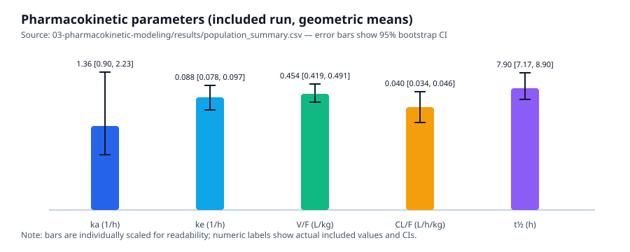
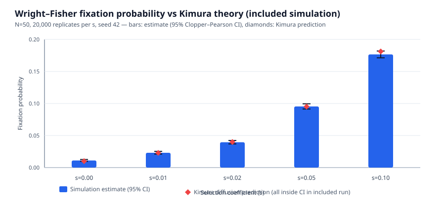

# Results Dashboard (Included Artifacts)

This dashboard summarizes **artifacts included in the repository**. It does **not** fabricate experimental results. Projects that depend on external real datasets (e.g., Sleep-EDF downloads, UCI CSV not bundled, airway exports) document how to reproduce real-data runs in their respective READMEs; quantitative real-run outputs for those projects are generated by the user when data are available.

## Pharmacokinetic Modeling (included run)

**Source:** `03-pharmacokinetic-modeling/results/population_summary.csv` (run on included `data/Theoph.csv`)

| Parameter | Geometric mean | 95% CI (low) | 95% CI (high) |
|---|---:|---:|---:|
| ka (1/h) | 1.359 | 0.898 | 2.230 |
| ke (1/h) | 0.088 | 0.078 | 0.097 |
| V/F (L/kg) | 0.454 | 0.419 | 0.491 |
| CL/F (L/h/kg) | 0.040 | 0.034 | 0.046 |
| t½ (h) | 7.898 | 7.165 | 8.904 |

Additional included figures: [`subject_fits.png`](../03-pharmacokinetic-modeling/results/figures/subject_fits.png), [`accumulation.png`](../03-pharmacokinetic-modeling/results/figures/accumulation.png)

## Wright–Fisher Evolution Simulator (included simulation)

**Source:** `05-wright-fisher-evolution-simulator/results/fixation_probability.csv` (N=50, 20,000 replicates per *s*, seed 42)

| s | Estimated P(fix) | 95% CI (CP) | Kimura theory | Theory in CI |
|---:|---:|---:|---:|:---:|
| 0.00 | 0.0111 | [0.0097, 0.0127] | 0.0100 | Yes |
| 0.01 | 0.0231 | [0.0211, 0.0253] | 0.0229 | Yes |
| 0.02 | 0.0396 | [0.0369, 0.0423] | 0.0399 | Yes |
| 0.05 | 0.0954 | [0.0914, 0.0996] | 0.0952 | Yes |
| 0.10 | 0.1766 | [0.1713, 0.1820] | 0.1813 | Yes |

Additional included figures: [`fixation_vs_s.png`](../05-wright-fisher-evolution-simulator/results/figures/fixation_vs_s.png), [`heterozygosity.png`](../05-wright-fisher-evolution-simulator/results/figures/heterozygosity.png), [`trajectories.png`](../05-wright-fisher-evolution-simulator/results/figures/trajectories.png)

## Other projects (pipelines, tests, and demo artifacts)

| Project | Included artifacts | Real-data result status |
|---|---|---|
| EEG Sleep Band Power | Source, tests, evaluator problem, demo media (`docs/demo.mp4`, thumbnail) | Real Sleep-EDF results require user run after data download; `--synthetic` mode is a labeled demo (not real findings) |
| Heart Failure Survival Prediction | Source, tests, evaluator/leakage demo, demo media | Real UCI dataset results require user run with provided CSV; `--synthetic` cohort is a labeled demo |
| RNA-seq Differential Expression | Source, tests, evaluator problem, demo media, export/make-synthetic scripts | Real airway (GSE52778) results require user export/run; synthetic counts are labeled demos (not real biology) |

For full methodology and reproduction steps, see each project's `README.md`.